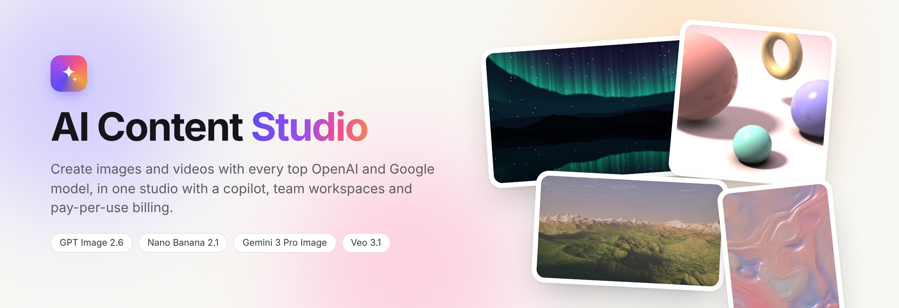
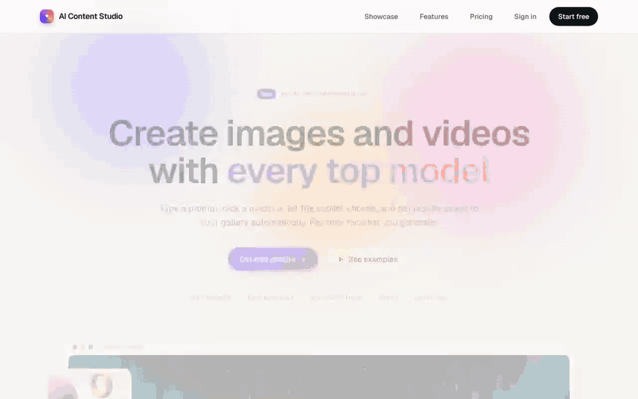
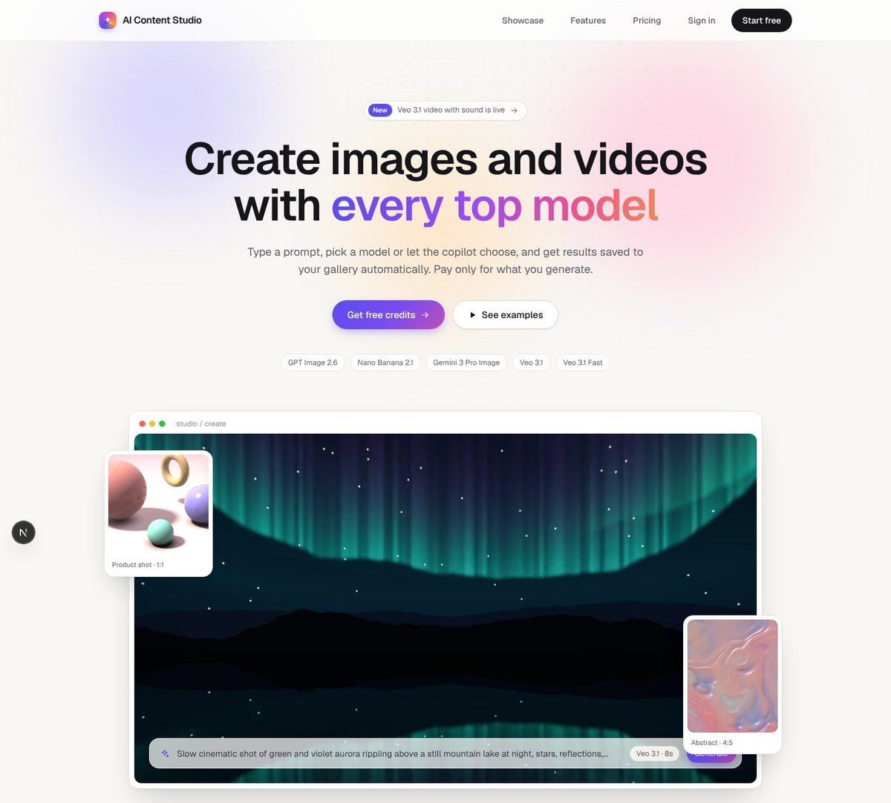
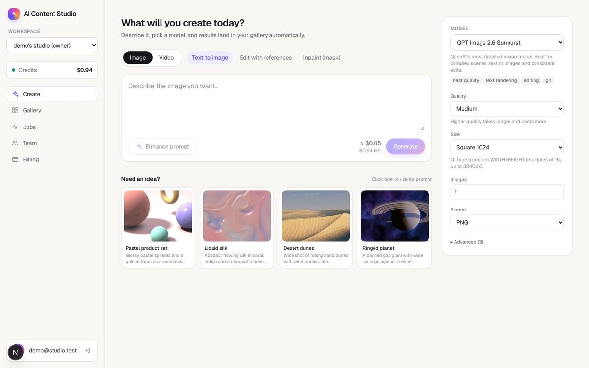
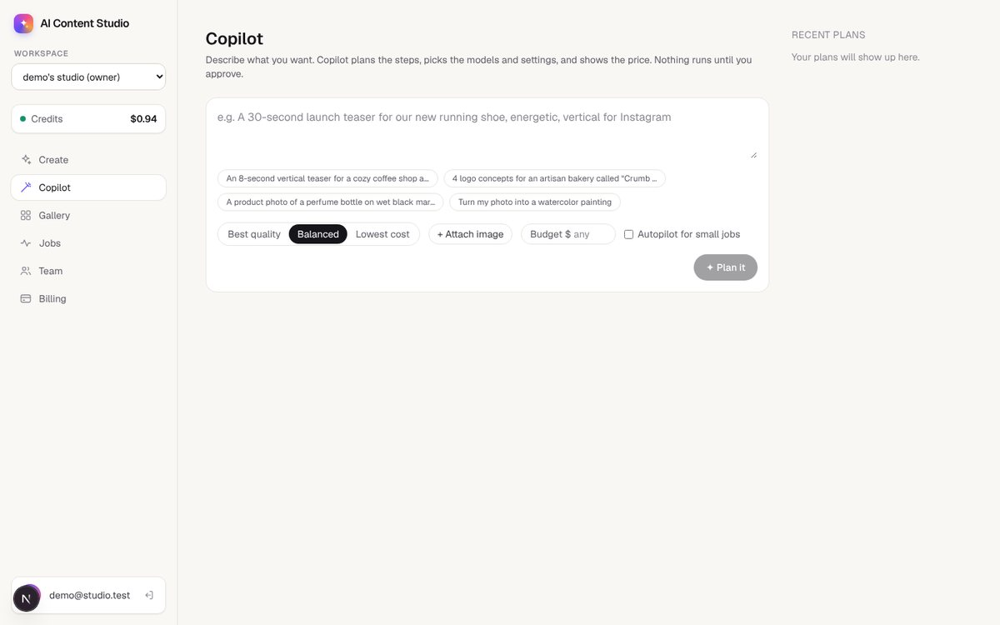
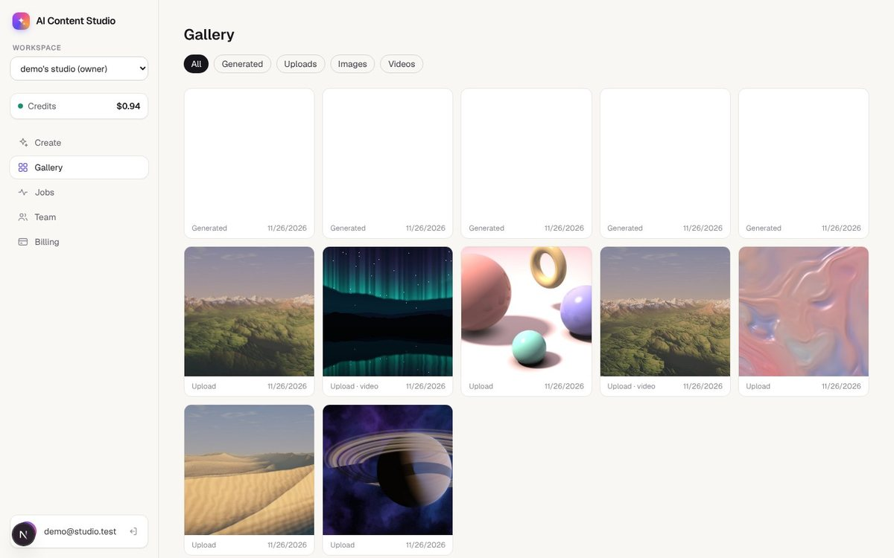
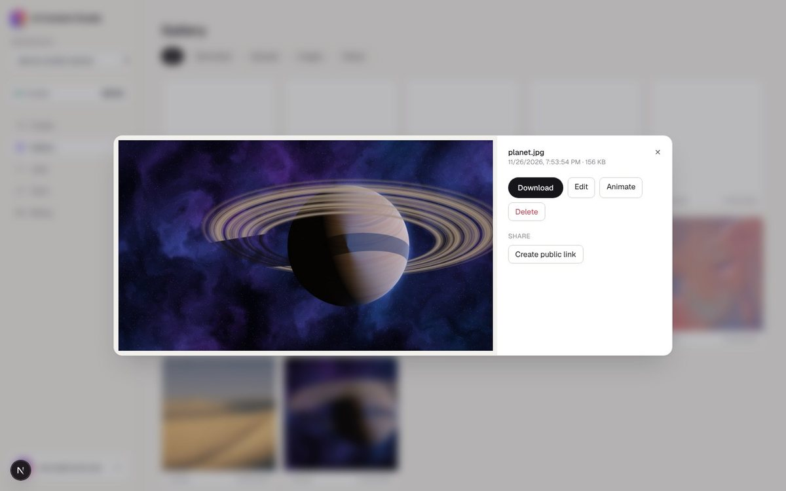
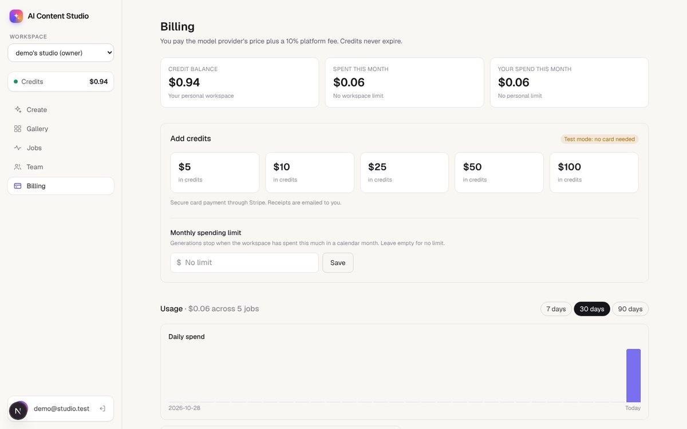
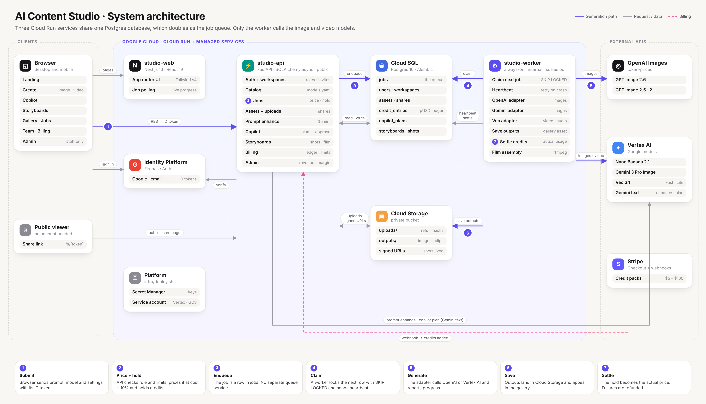

<div align="center">



<h3>Every top image and video model. One studio.</h3>

<p>
Generate with OpenAI GPT Image, Google Gemini image models and Veo 3.1 from a single prompt box.<br/>
Let the Copilot plan multi-step jobs, keep everything in a shared gallery, and pay only for what you generate.
</p>

<p>


</p>

<p>
<a href="#see-it-in-action">Demo</a> ·
<a href="#features">Features</a> ·
<a href="#screenshots">Screenshots</a> ·
<a href="#architecture">Architecture</a> ·
<a href="#run-locally">Run locally</a> ·
<a href="#deploy-to-google-cloud">Deploy</a>
</p>

</div>

---

## See it in action

<div align="center">

<br/>
<sub>Landing page → sign-in → create → gallery → jobs → billing. <a href="docs/media/walkthrough.mp4">Full-quality MP4</a></sub>
</div>

## Features

<table>
<tr>
<td width="33%" valign="top">

**🎨 Text to image**<br/>
GPT Image 2.6 and Gemini image models (Nano Banana 2.1, 3 Pro and more) at every size and quality they offer.

</td>
<td width="33%" valign="top">

**🖌️ Edit and inpaint**<br/>
Combine reference images, or paint a mask in the browser and change just that area.

</td>
<td width="33%" valign="top">

**🎬 Text and image to video**<br/>
Veo 3.1, Fast and Lite, with sound. Live progress while it renders.

</td>
</tr>
<tr>
<td valign="top">

**🪄 Copilot**<br/>
Describe the goal; it plans the steps, picks models and settings, and shows the price before anything runs.

</td>
<td valign="top">

**🖼️ Auto-saved gallery**<br/>
Every result is kept with its prompt and settings, ready to reuse or share by public link.

</td>
<td valign="top">

**👥 Teams and roles**<br/>
Workspaces with owner, admin, member and viewer roles, invitations and per-member limits.

</td>
</tr>
<tr>
<td valign="top">

**💳 Pay per use**<br/>
Prepaid credits via Stripe. Price = provider cost + 10%. Free credits on signup.

</td>
<td valign="top">

**📊 Usage and admin**<br/>
Spend charts, ledger history, monthly limits, and a staff dashboard for revenue and margin.

</td>
<td valign="top">

**⚙️ Config-driven catalog**<br/>
Models, parameters and prices live in one YAML file; the UI builds its controls from it.

</td>
</tr>
</table>

## Screenshots

<table>
<tr>
<td width="50%"><p align="center"><sub><b>Landing page</b></sub></p></td>
<td width="50%"><p align="center"><sub><b>Create</b>: prompt, model, parameters, ideas</sub></p></td>
</tr>
<tr>
<td><p align="center"><sub><b>Copilot</b>: goal to plan to approval</sub></p></td>
<td><p align="center"><sub><b>Gallery</b>: everything auto-saved</sub></p></td>
</tr>
<tr>
<td><p align="center"><sub><b>Asset detail</b>: download, edit, animate, share</sub></p></td>
<td><p align="center"><sub><b>Billing</b>: credits, limits, usage</sub></p></td>
</tr>
</table>

<sub>Showcase images and loops are original procedural renders made for this project (see <a href="docs/sample-media">docs/sample-media</a>), not model outputs.</sub>

## Tech stack

| Layer | Choice |
| --- | --- |
| Frontend | Next.js 16 (app router), React 19, Tailwind CSS v4 with a light design-token theme |
| API | FastAPI, SQLAlchemy (async), Alembic, Pydantic |
| Jobs | Postgres queue with `SELECT … FOR UPDATE SKIP LOCKED`, no Redis |
| Models | OpenAI Images API, Vertex AI (Gemini image, Veo 3.1) |
| Auth | Google Identity Platform (Firebase Auth); dev auth locally |
| Storage | Cloud Storage with signed URLs; local disk in dev |
| Billing | Stripe Checkout, credit ledger in micro-USD |
| Hosting | Cloud Run (web, API, worker) + Cloud SQL |

## Architecture

<p align="center">
  
</p>
<p align="center"><sub>Numbered steps follow one generation from submit to settle. Source: <a href="docs/media/architecture.html">docs/media/architecture.html</a> (open in a browser to edit, then re-screenshot).</sub></p>

### Services

| Service | Runs on | What it does |
| --- | --- | --- |
| **studio-web** | Cloud Run, public | Next.js app: landing page, sign-in, studio. Talks to the API directly from the browser and polls jobs for live progress. |
| **studio-api** | Cloud Run, public | FastAPI. Verifies ID tokens, enforces roles, prices and validates requests from the catalog, holds credits, enqueues jobs, serves assets via signed URLs, runs Copilot planning, storyboards, billing and Stripe webhooks. |
| **studio-worker** | Cloud Run, always-on, internal | Claims queued jobs, calls the provider adapter, saves outputs to storage and the gallery, settles credits, assembles storyboard films with ffmpeg. Scale it out by adding instances. |
| **Cloud SQL** | Postgres 16 | Source of truth and the job queue. Schema managed by Alembic. |
| **Cloud Storage** | Private bucket | Uploads and generated media, only reachable through short-lived signed URLs. |

### Key design decisions

| Decision | Why |
| --- | --- |
| **Postgres as the queue** (`SELECT … FOR UPDATE SKIP LOCKED`) | One less service to run. Many workers can claim jobs safely; a job is a normal row you can query. |
| **Heartbeats + retries** | A running job heartbeats. If a worker dies, the job is retried up to `JOB_MAX_ATTEMPTS`. |
| **Hold, then settle** | The estimated price is held when a job is submitted and settled to actual usage when it finishes, so two jobs can't overspend the same balance. |
| **Config-driven catalog** | `backend/app/catalog/models.yaml` defines models, parameters, validation and prices. The UI builds its controls from it. |
| **Generation runs in the worker** | Slow or failing image and video calls never block API requests. (The API only makes short Gemini text calls for prompt enhancement and Copilot planning.) Keys live in Secret Manager. |
| **Content-sniffed uploads** | File type is detected from the bytes, not the filename. Images and videos up to `MAX_UPLOAD_BYTES` (500 MB default). |

### Auth and roles

Sign-in uses **Google Identity Platform** (Firebase Auth). The browser sends an ID token; the
API verifies it and creates the user plus a personal workspace on first visit. Every resource
belongs to a workspace (`backend/app/core/permissions.py`):

| Role | Can do |
| --- | --- |
| **Viewer** | Browse the gallery, jobs and members |
| **Member** | Everything a viewer can, plus upload and generate |
| **Admin** | Everything a member can, plus invite, remove and change roles (not the owner) |
| **Owner** | Everything, plus rename or delete the workspace and manage billing |

## Repository layout

```
backend/    FastAPI API + worker (Python 3.12+, uv, SQLAlchemy, Alembic)
frontend/   Next.js app router + Tailwind (landing page, sign-in, studio)
infra/      Cloud Run deploy script
docs/       Roadmap, sample-media shaders, README media
```

## Run locally

Requirements: Python 3.12+, [uv](https://docs.astral.sh/uv/), Node 22, Postgres 16
(or Docker).

**With Docker:** `docker compose up --build`, then open http://localhost:3000.

**Without Docker:**

```bash
# Backend
cd backend
cp .env.example .env            # edit DATABASE_URL if needed
uv sync
uv run alembic upgrade head
uv run uvicorn app.main:app --reload --port 8000          # API
uv run uvicorn app.worker.main:app --port 8081            # worker (second terminal)

# Frontend
cd frontend
cp .env.example .env.local
npm install
npm run dev
```

Local mode uses **dev auth** (sign in with any email, no password) and stores media in
`backend/.media`. With `ENABLE_DEBUG_OPERATIONS=true` the model picker also offers
**Debug pixel** (instant placeholder images) and **Debug clip** (a simulated video job,
needs ffmpeg), so you can try every screen without spending provider credits.

To use real models locally, set `OPENAI_API_KEY`, `GCP_PROJECT_ID` and sign in to Google
Cloud (`gcloud auth application-default login`). Check that every catalog model is
reachable with `uv run python -m scripts.check_models`.

## Models

The model list lives in `backend/app/catalog/models.yaml`: each model's operations,
parameters (the UI builds its controls from these), validation rules and prices. Add,
retire or re-price a model there; no code change needed for a new model on an existing
adapter. Prices marked `verified: false` came from secondary sources and must be checked
against the provider price lists before billing customers.

As of November 2026: OpenAI GPT Image 2.6 / 2.5 / 2 for images (Sora was shut down in
September 2026), Google Gemini image models (Nano Banana 2.1, 3.1 Flash, 3 Pro, Flash Lite)
and Veo 3.1 / Fast / Lite for video.

## Credits and billing

Every workspace has a prepaid credit balance in US dollars. New users get
`SIGNUP_CREDIT_USD` (default $1) in their personal workspace; team workspaces start at zero.

- **Price** = provider cost × 1.10 (the 10% platform fee is `PLATFORM_FEE` in `app/catalog/pricing.py`).
- When a job is submitted, its estimated price is **held** (deducted). When it finishes, the
  hold is **settled** to the actual price (token usage when the provider reports it, or the
  estimate scaled to the number of outputs produced). Failed jobs and jobs canceled while
  queued are refunded in full; canceling a running job charges the estimate, because the
  provider has already started.
- Every change is a row in `credit_entries` (the ledger) and the balance is updated under a
  row lock, so two jobs can't overspend the same dollars.
- Owners can set a **monthly limit** for the workspace; admins can set one per member.
- Owners buy credit packs (`CREDIT_PACKS_USD`, default $5/$10/$25/$50/$100) through **Stripe
  Checkout**. Credits are added by the webhook, idempotently (Stripe retries are safe).

### Stripe setup

1. In the Stripe dashboard, create a webhook endpoint at
   `https://<api>/v1/billing/stripe/webhook` for `checkout.session.completed` and
   `checkout.session.async_payment_succeeded`.
2. Deploy with `STRIPE_SECRET_KEY=sk_live_... STRIPE_WEBHOOK_SECRET=whsec_... ./infra/deploy.sh`
   (stored in Secret Manager). Use `sk_test_` keys first.
3. Locally: `stripe listen --forward-to localhost:8000/v1/billing/stripe/webhook`. Without
   Stripe keys and with `ENABLE_DEBUG_OPERATIONS=true`, the Billing page offers free test top-ups.

### Staff admin

`uv run python -m scripts.make_admin someone@company.com` makes a user platform staff
(`--revoke` to undo). Staff see an **Admin** page with revenue, provider cost, margin,
unspent customer credit, and a customer list where they can add or remove credit with a reason.

## Copilot

The Copilot page turns a goal ("an 8-second vertical teaser for a coffee shop") into a
plan of generation steps: which model, which settings, the prompt for each step, and the
price. A step can use an earlier step's output, e.g. design a key frame, then animate it.
Nothing runs until the user approves; "Autopilot" runs plans under
`COPILOT_AUTORUN_MAX_USD` (default $0.50) straight away.

- **Planner** (`app/services/copilot/planner.py`): Gemini (`COPILOT_MODEL`) plans from the
  model catalog when a GCP project is configured; otherwise built-in rules do it
  (`COPILOT_PLANNER=auto|llm|rules`). Every plan is then checked against the catalog:
  unknown models are swapped, invalid settings dropped, inputs rewired, prices computed,
  and models downgraded to fit a budget.
- **Runner** (`app/services/copilot/executor.py`): steps become normal jobs (same billing
  and limits). The worker starts the next steps when a job finishes and skips dependent
  steps when one fails. Users can edit steps, remove them, ask for changes, or stop a plan.
- Local testing: `COPILOT_SIMULATE=true` (with `ENABLE_DEBUG_OPERATIONS=true`) runs plan
  steps on the free debug models.

### Tests

```bash
cd backend && createdb studio_test && uv run pytest
cd frontend && npm run lint && npm run build
```

## Deploy to Google Cloud

1. In the Google Cloud console, enable **Identity Platform** and turn on the Google and
   Email/Password providers. Copy the Web API key.
2. Run:

   ```bash
   PROJECT_ID=your-project REGION=us-central1 OPENAI_API_KEY=sk-... FIREBASE_API_KEY=... ./infra/deploy.sh
   ```

   This creates the bucket, Cloud SQL database, service account, runs migrations, and
   deploys `studio-api`, `studio-worker` and `studio-web`. It is safe to re-run.
3. Add the printed web domain to Identity Platform's authorized domains.

Production refuses to start with dev auth or local storage.

## Configuration

All backend settings are environment variables; see `backend/app/core/config.py` and
`backend/.env.example`. Frontend settings are `NEXT_PUBLIC_*` variables in
`frontend/.env.example` (baked in at build time).
